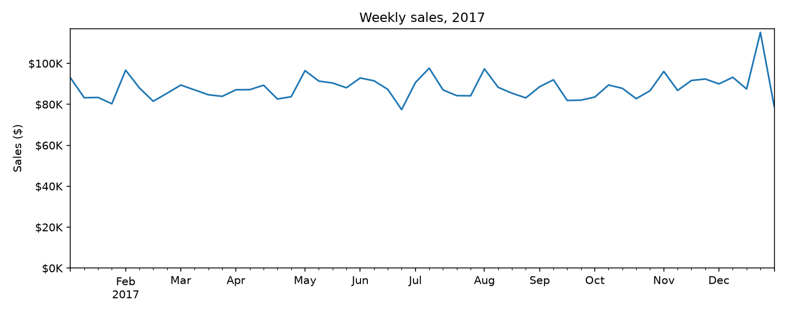
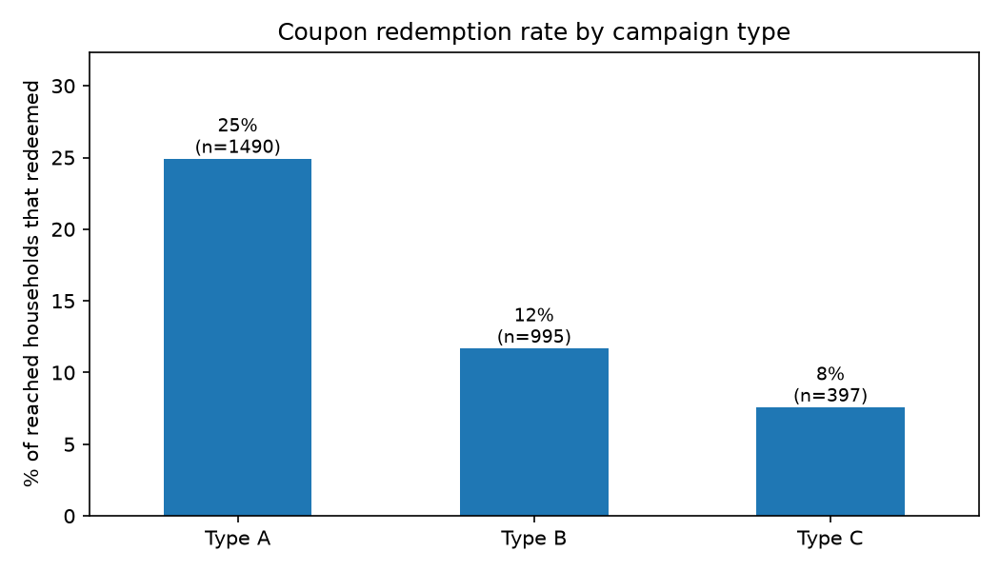
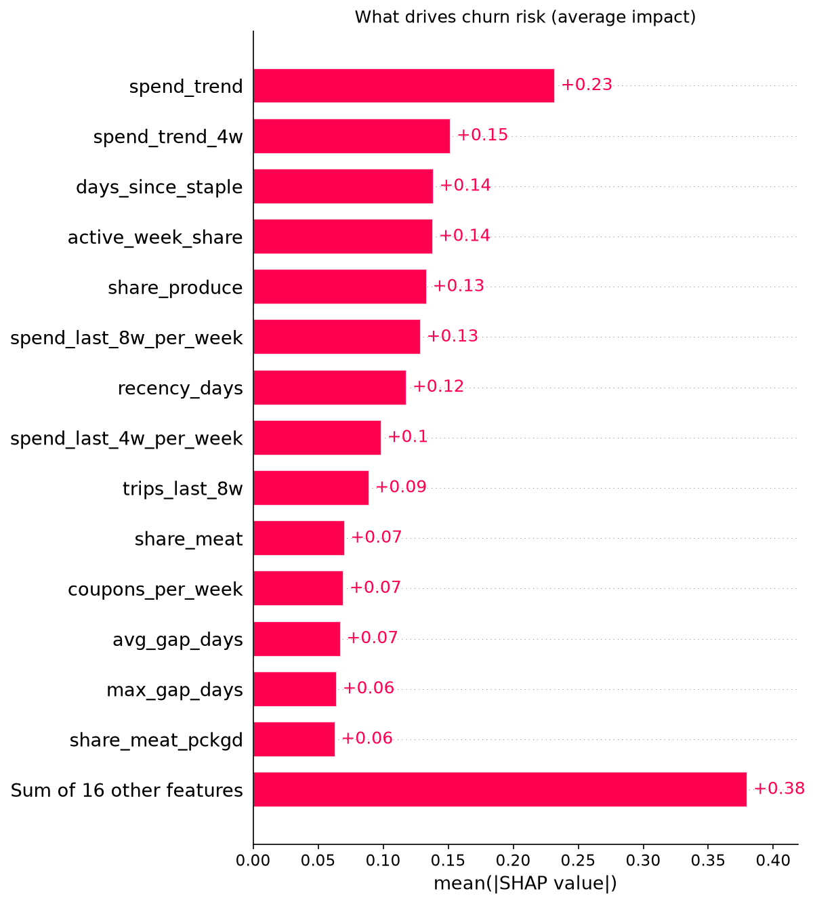
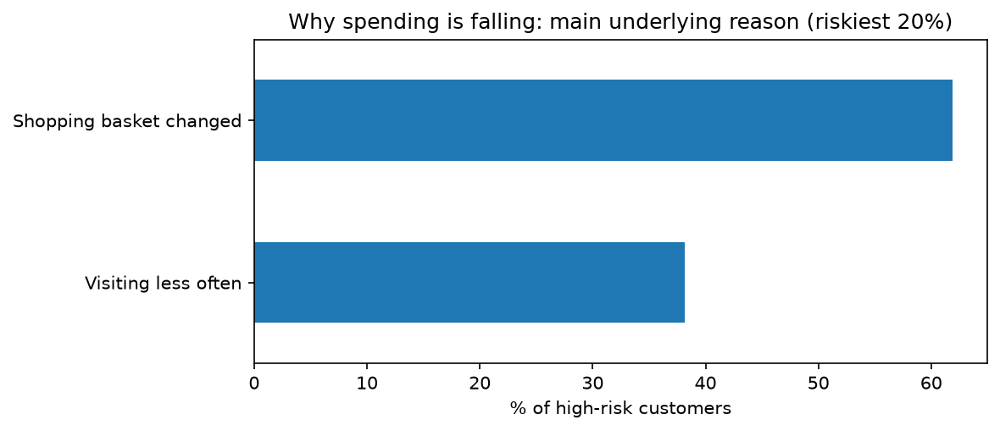

# Dimaagi Cart

**Your store's smart cart: spot drifting regulars, see why, and win them back.**

*Dimaagi* is Urdu for smart, brainy. Until v0.3.2 the project was called WinBack AI; it was renamed because that name is already used by another company.

Dimaagi Cart is an open-source churn intelligence project that combines **machine learning** with **marketing analytics**. It predicts which regular customers are about to pull back their spending, explains each prediction in plain English, and uses **RAG (retrieval-augmented generation)** to turn those explanations into cited, ready-to-send win-back campaigns. It will be packaged as a Windows desktop app.

> **Status:** Phase 1 (churn model and explanations) and Phase 2 (RAG: cited "why" summaries, campaign kits and an assistant chat) are complete. Phase 3 (desktop app) works end to end: a Windows installer (v0.3.2, unsigned) with bring-your-own-data. Publishing it on GitHub Releases is next. See the [Roadmap](#roadmap).

---

## Table of contents
1. [The problem](#the-problem)
2. [Headline results](#headline-results)
3. [The data](#the-data)
4. [What the data revealed: exploration findings](#what-the-data-revealed-exploration-findings)
5. [Defining churn](#defining-churn)
6. [Feature engineering](#feature-engineering)
7. [Modelling journey](#modelling-journey)
8. [Why customers leave: SHAP explanations](#why-customers-leave-shap-explanations)
9. [Phase 2: From "who" to "why" and "what" (RAG)](#phase-2-from-who-to-why-and-what-rag)
10. [How the RAG system was evaluated](#how-the-rag-system-was-evaluated)
11. [Phase 3: the desktop app](#phase-3-the-desktop-app)
12. [Key design decisions](#key-design-decisions)
13. [Limitations](#limitations)
14. [Project structure](#project-structure)
15. [How to run](#how-to-run)
16. [Roadmap](#roadmap)
17. [Release notes](#release-notes)
18. [Acknowledgements](#acknowledgements)

---

## The problem

Most businesses only notice a lost customer after they've stopped buying, and by then it's too late. In reality, customers rarely vanish overnight. They **drift**: they visit a little less often, skip their usual items, and quietly move their main shop elsewhere.

Dimaagi Cart is built to catch that drift early and answer three questions a brand actually cares about:

1. **Who** is at risk of leaving? *(Phase 1: the churn model)*
2. **Why** are they pulling back? *(Phase 1: SHAP explanations, plus Phase 2: RAG over real customer reviews)*
3. **What** should we do to win them back? *(Phase 2: campaign kits and the assistant chat)*

---

## Headline results

### Phase 1

| Metric (tested on a future time period) | Dimaagi Cart model | Recency rule* | Random |
|---|---|---|---|
| ROC-AUC | **0.764** | 0.684 | 0.500 |
| PR-AUC | **0.469** | n/a | 0.226 |
| At-risk customers reached by contacting the riskiest **10%** | **24%** | 24% | 10% |
| At-risk customers reached by contacting the riskiest **20%** | **44%** | 38% | 20% |
| At-risk customers reached by contacting the riskiest **30%** | **57%** | 50% | 30% |

\*The recency rule ranks customers by days since their last trip. It's the simple baseline any model must beat.

All numbers come from the reproducible script (`python -m src.train`, saved in `models/metrics.json`), tested on the newest period (Nov–Dec 2017, 2,297 regular customers). Earlier notebook figures are kept in [`reports/model_log.md`](reports/model_log.md).

**In plain terms:** if a brand can only contact 1 in 5 customers, Dimaagi Cart reaches **44% of everyone about to churn**, which is **2.2× better than random** and **6 points better than the recency rule**. The model's edge over the recency rule appears at 20–30%; at 10% they tie. The model's edge comes from catching **silent churners**: customers who still shop, but whose baskets are shrinking.

### Phase 2

| What was measured | Result |
|---|---|
| Retrieval (45 labelled queries), hybrid search + reranking | MRR@10 **0.767 → 0.844**, P@5 **0.591 → 0.738** |
| Relevance labels vs. a human | **87%** agreement, Cohen's κ **0.73** |
| "Why" summaries: lapsed categories explained with real evidence | **5/9 → 8/9** (the 9th is a documented evidence gap) |
| Campaign kits, human review (1–5: relevant, specific, on-brand, actionable, honest) | **3.6 → 4.2** |
| Assistant chat (12 questions) | Routing **100%**, citation validity **100%**, mean latency **2.9s** |
| Faithfulness (229 claims over 2 runs, judged against the exact sources, flags reviewed by hand) | **97%**: 2 unsupported (swapped segment numbers, now caught by a code check), 10 overstatements of certainty, **no invented facts** |

**In plain terms:** every reason, campaign and chat answer points to the review, report page or sales number it came from, and code checks those citations before anything reaches the owner.

---

## The data

**dunnhumby: *The Complete Journey*** is a real, anonymised grocery retail dataset released by dunnhumby (the data science company behind Tesco Clubcard) for learning and research.

| Table | Rows | What it contains |
|---|---|---|
| transactions | 1,469,307 | Every item bought, with price, discounts, store and timestamp |
| products | 92,331 | Department, category, brand, package size |
| demographics | 801 | Age, income, household size and composition (32% of households) |
| campaigns | 6,589 | Which household received which campaign |
| campaign_descriptions | 27 | Campaign type and dates |
| coupon_redemptions | 2,102 | Which household redeemed which coupon, and when |

- **Period:** 1 Jan 2017 to 1 Jan 2018
- **Customers:** 2,469 households making 155,848 shopping trips

**Why this dataset:** real customer-level data from large companies is rarely public, and many "brand" datasets online are synthetic. I chose real, anonymised data over recent synthetic data for credibility. It also includes **marketing campaigns and coupon redemptions**, which is rare and lets the project connect churn directly to marketing.

### Phase 2: two knowledge bases

| Knowledge base | Source | Size | Answers |
|---|---|---|---|
| **Grocery reviews** | [Yelp Open Dataset](https://www.yelp.com/dataset), grocery stores only | 25,000 reviews, weighted toward 1–3 stars | The customer's voice: **why** shoppers leave |
| **Marketing trends** | 11 public reports: Listrak, Klaviyo, Merkle, Bond, Optimove, Sprout Social, Hootsuite, McKinsey, Deloitte, FMI and a MailGenius win-back playbook (listed in [`config/trend_sources.csv`](config/trend_sources.csv)) | 371 page-cited chunks | **What** tactics work |

Neither is redistributed in this repo: the Yelp data is used under Yelp's terms, and the reports are copyrighted. [How to run](#how-to-run) explains how to download them.

---

## What the data revealed: exploration findings

Every finding below is backed by numbers from the data and ends with a "so what". Full write-ups with charts are in [`reports/findings.md`](reports/findings.md).

### 1. Sales are stable all year
- Weekly sales averaged **$88.2K**, with half of all weeks between **$83.8K and $91.4K**. Week-to-week variation was only **6.9%**.
- The peak week was **24 Dec ($115.1K, +31%)**, and the low week was **25 Jun ($77.4K)**.
- **So what:** there's no seasonal slump, so when a customer stops shopping, it's a real signal, not a quiet season.



### 2. A loyal core drives a big share of visits
- The typical household made **43 trips** in the year (median), nearly weekly.
- **42.9%** shopped weekly or more, and **17.1%** twice a week or more.
- The **top 10% of households made 35% of all trips.**
- **So what:** gaps of several weeks are unusual and easy to spot, which makes them a strong early-warning signal. The top 10% are the customers a brand can least afford to lose.

### 3. Half of sales come from one department, led by weekly staples
- Total sales were **$4.60M**. Grocery made up **50.4%**, Drug/General Merchandise **13.0%**, and Fuel **7.2%** (over 70% combined).
- Inside Grocery, soft drinks lead, followed by staples: milk, cheese, bread and cereal.
- **So what:** staples are bought every week, so when a customer stops buying them here, they've likely moved their main shop.

### 4. Higher-income, mid-age family households spend the most
*(Based on the 32% of households with demographic data.)*

| Income band | Households | Median yearly spend |
|---|---|---|
| Under $35K | 212 | $2,294 |
| $35–74K | 364 | $2,564 |
| $75–149K | 168 | $3,030 |
| $150K+ | 57 | $4,793 |

- Spend peaks at ages **35–44 ($3,038)**, which is **45% more** than 65+ ($2,089).
- Households of **4 people spend 40% more** than single-person households.

### 5. Campaigns reach most customers, but the most-used type performs worst
- 27 campaigns reached **63%** of households. Only **26%** of those reached ever redeemed a coupon, and **910 households (37%) were never targeted.**

| Campaign type | Campaigns | Redemption rate |
|---|---|---|
| A | 4 | **24.9%** |
| B | 17 | 11.7% |
| C | 6 | 7.6% |

- Type A converts **more than 2× better** than Type B, yet Type B made up **63%** of campaigns.
- Coupon redeemers spend **$3,329/year**, compared with $1,674 for targeted non-redeemers and $364 for untargeted households. This reflects **targeting (selection bias), not proof that coupons cause higher spend.**
- The correlation between weekly campaign volume and weekly sales was just **0.12**.
- **So what:** shift budget toward Type A-style campaigns, and close the "never targeted" blind spot.



---

## Defining churn

Grocery shoppers rarely disappear completely within two months, so "full churn" is too blunt.

| Definition | Customers flagged | Problem |
|---|---|---|
| **Full churn:** no purchase in the next 2 months | 134 (5.8%) | Catches customers only after they've gone |
| **Silent churn:** weekly spend drops 50%+ in the next 2 months (including stopping) | **509 (22.2%)** | Catches customers *while they can still be won back* |

**Dimaagi Cart uses silent churn.** It applies to **regular customers** (5+ trips before the cutoff) and compares each customer's average weekly spend **before** a cutoff date with the **61 days after**.

- **The rate is stable across the year:** 20.5% (Jul–Aug), 23.2% (Sep–Oct) and 22.7% (Nov–Dec), so the label reflects real behaviour, not a seasonal quirk.
- **It's conservative:** December normally raises spending, so anyone flagged in the final window pulled back during the busiest season of the year.

---

## Feature engineering

All features are built **only from data on or before each cutoff date**, to prevent data leakage. The final model uses **30 behavioural features**, each tied to an exploration finding.

| Group | Examples | Linked finding |
|---|---|---|
| **Recency & frequency** | days since last trip, trips per week, average and longest gap between trips, share of active weeks | Finding 2 |
| **Recent trends** | spend and trips in the last 4 and 8 weeks vs. the customer's usual | Finding 2 |
| **Spend** | weekly spend, average basket value, discount share | Findings 1, 3 |
| **Basket mix** | share of spend by department (grocery, produce, meat, fuel…), staples share, days since last staple purchase | Finding 3 |
| **Marketing** | campaigns per week, Type A campaigns per week, coupons redeemed per week, ever targeted | Finding 5 |

Logic lives in [`src/features.py`](src/features.py) and [`src/labels.py`](src/labels.py), so the notebook and the training script use exactly the same code.

---

## Modelling journey

Every experiment is recorded in [`reports/model_log.md`](reports/model_log.md). The short version:

| # | What changed | ROC-AUC | Lesson |
|---|---|---|---|
| 0 | Baseline: rank by days since last trip | 0.685 | The number to beat |
| 1 | XGBoost (depth 4), single random split | 0.686 | No better than the rule: overfitting |
| 2 | Simpler, regularised models, 5-fold cross-validation | RF 0.765 · XGB 0.763 · LR 0.741 | Regularisation fixed overfitting: +0.08 over the rule |
| 3 | Added 4-week trend + consistency features | RF 0.773 · XGB 0.765 | Small, consistent gain |
| 4 | **Rolling snapshots + time-based validation** (train on past, test on future) | XGB 0.760 | Realistic test; slight, expected drop vs. cross-validation |
| 5 | Removed cumulative features that grow with time; replaced with per-week rates | XGB 0.759 | Removed a calendar shortcut; score held steady |
| 6 | **Ablation: removed demographics** | **XGB 0.767** | Better with half the features (56 → 30) |
| 7 | Final choice: XGBoost vs. random forest | XGB 0.767 · RF 0.770 | A tie; XGBoost chosen (see below) |
| — | Reproduced with `src/train.py` | **0.764** | Script matches notebook within 0.003 |

### Validation approach
Instead of a single random split, Dimaagi Cart builds **three rolling snapshots** of the customer base:

| Snapshot | Features from data up to | Churn measured over |
|---|---|---|
| 1 | 1 Jul 2017 | Jul–Aug |
| 2 | 1 Sep 2017 | Sep–Oct |
| 3 | 1 Nov 2017 | Nov–Dec |

The model trains on snapshots 1–2 and is tested on snapshot 3: **trained on the past, judged on the future**, exactly as it would run in production. For the saved model, it is then retrained on all snapshots so it learns from the most recent behaviour.

---

## Why customers leave: SHAP explanations

SHAP shows how much each feature pushed a customer's risk up or down, so every prediction comes with reasons.

**What drives risk:**
- **Falling spend** (last 4–8 weeks vs. usual) is the strongest warning sign.
- **A low share of fresh produce** raises risk. Customers who buy their fresh food elsewhere are using this store for top-ups.
- **A long time since buying staples** (milk, bread, cheese, cereal) raises risk.
- **Coupon redeemers** are markedly *less* likely to churn.

**The reason behind falling spend** (riskiest 20% of customers, features grouped into themes):

| Underlying reason | Share | Win-back idea |
|---|---|---|
| **Shopping basket changed:** less produce and fewer staples | **61.9%** | Category-specific offers on the items they stopped buying |
| **Visiting less often:** longer gaps, fewer trips | **38.1%** | Visit-frequency rewards and timely reminders |
| Low marketing engagement | 0% | — |

**The key insight:** *churn starts in the basket, not at the door.* Most at-risk customers keep visiting while quietly moving their main shop elsewhere, which a brand can detect weeks before they stop coming.




---

## Phase 2: From "who" to "why" and "what" (RAG)

Phase 1 tells a store **who** is drifting. Phase 2 is built for one person: **the owner of a small independent grocery store**, who has no marketing team and needs to know *why* customers are leaving and *what to send them*, with proof.

### The pipeline

```
 at-risk segments (src/segments.py)
   who · how many · $ at risk · lapsed categories
              │
              ▼
 ┌─────────────────────────┐  ┌─────────────────────────┐  ┌──────────────────────────┐
 │ Grocery reviews KB      │  │ Marketing trends KB     │  │ Store profile            │
 │ 25,000 Yelp reviews     │  │ 11 reports, 371 chunks  │  │ config/store_profile.yaml│
 └────────────┬────────────┘  └────────────┬────────────┘  └─────────────┬────────────┘
              └──────────────┬─────────────┘                             │
                             ▼                                           │
       hybrid retrieval: vector + BM25 → RRF → local reranker            │
                             │                                           │
         ┌───────────────────┼───────────────────────────┐               │
         ▼                   ▼                           ▼               │
  "Why" summaries     Campaign kits  ◄──────────────────────────────────┘
  (src/rag/generate)  (src/rag/campaign)        Assistant chat
                                                (src/rag/assistant)
```

### The segments

| Segment | Customers | Revenue at risk / week | Per customer | Lapsed categories |
|---|---|---|---|---|
| Core · Basket changed | 272 | $3,532 | $12.98 | bread, milk, cheese |
| Core · Visiting less | 163 | $2,701 | $16.57 | milk, bread, cheese |
| High-value · at risk | 34 | $2,580 | $75.87 | milk, soup, bread |
| **Total** | **469** | **$8,812** | | |

- At-risk customers drop milk and bread **4–10× more often** than healthy ones (Finding 8 in [`reports/findings.md`](reports/findings.md)).
- Just **34 high-value customers hold 29%** of the revenue at risk.
- **So what:** the owner knows exactly which staples to fix and which small group to call first.

### Hybrid retrieval

Plain vector search returned **sandwich reviews for "bread"**: close in meaning, wrong for a grocery shelf. BM25 keyword search catches exact words like "loaf" or "dented", but misses paraphrases. The two fail in opposite places, so Dimaagi Cart fuses them with **reciprocal rank fusion (RRF)** and re-sorts the top results with a **local cross-encoder** ([`src/rag/hybrid.py`](src/rag/hybrid.py)).

- **So what:** the evidence behind each reason is about buying groceries, not about the deli counter.

### "Why" summaries

[`src/rag/generate.py`](src/rag/generate.py) writes **3–5 cited reasons per segment**.

- Numbers come **only from the owner's sales data**.
- Reviews are framed as **shoppers at OTHER stores** (a proxy voice), never as "your customers said".
- Weak evidence goes into an explicit **"evidence gaps"** field: **cite or abstain**.
- **So what:** the owner gets likely causes they can check, not confident guesses.

### Campaign kits

[`src/rag/campaign.py`](src/rag/campaign.py) builds one kit per segment: **offer, email, SMS, social post, a 2-week send plan, metrics and an owner checklist.** A sample is in [`reports/sample_campaign_kits.md`](reports/sample_campaign_kits.md).

- **Fix first, then promise:** operational fixes (restock bread, check dairy dates) go on the owner's checklist. Any promise in a message is tagged **[CONFIRM]** until the owner has done it.
- **Store facts** come from [`config/store_profile.yaml`](config/store_profile.yaml), so the kit never invents a bakery, a loyalty programme or delivery.
- **Code checks** every kit:

| Check | Rule |
|---|---|
| Citation validity | Every ref must be a source the writer was given |
| SMS length | ≤ 160 characters, measured with the real placeholder length |
| Subject length | ≤ 60 characters |
| Offer economics | Minimum basket above the segment's median spend; discount ≤ 15% of it |
| Unsupported numbers | Every number must appear in the sources |
| Untagged promises | Improvement claims must carry [CONFIRM] |

- **So what:** the owner gets copy they can send today, without promising something the store hasn't done.

### Assistant chat

[`src/rag/assistant.py`](src/rag/assistant.py) answers the owner's questions in plain English. Gemini picks from **5 tools**: list segments, segment reasons, search reviews, search marketing trends, and get campaign kit.

- Refs are **self-describing**: `[S_highvalue]` is the high-value segment's sales data, `[K_corebasket]` is a campaign kit, `[R3]` a review, `[T2]` a report page.
- **Code checks** that every cited ref was really returned by a tool, and that **every number matches the citation right after it**.

> **You:** Which group of customers should I focus on first?
>
> **Assistant:** Focus on the High-value · at risk group first. They represent $2,579.53 in weekly revenue at risk across just 34 customers [S_highvalue], the highest value per customer at $75.87 [S_highvalue], compared with $16.57 for Core Visiting less [S_corevisiting] and $12.98 for Core Basket changed [S_corebasket].

- **So what:** the owner can ask in their own words and check every number in one click.

---

## How the RAG system was evaluated

Every experiment, including the ones that failed, is recorded in [`reports/rag_log.md`](reports/rag_log.md).

### Retrieval (45 labelled queries)

| Method | Hit@5 | MRR@10 | P@5 | ms/query |
|---|---|---|---|---|
| Vector | 0.800 | 0.767 | 0.591 | 82 |
| BM25 | 0.978 | 0.741 | 0.640 | 83 |
| Hybrid (RRF) | 0.911 | 0.817 | 0.653 | 124 |
| **Hybrid + rerank** | **0.978** | **0.844** | **0.738** | 1,675 |

- BM25 wins **product** queries (0.80 vs 0.69 MRR). Vector wins **issue** queries (0.87 vs 0.71).
- The reranker won on average but hurt some product queries.
- **So what:** hybrid + rerank for batch generation, where quality matters most; plain hybrid (0.12s) for the chat, where speed matters. Details in [`reports/retrieval_eval.md`](reports/retrieval_eval.md).

### Generation

| Output | Before → after | What made the difference |
|---|---|---|
| "Why" summaries (lapsed categories with real evidence) | 5/9 → **8/9** | Hybrid retrieval |
| Campaign kits (human review, 1–5) | 3.6 → **4.2** | Store profile + structured offer + code checks, **not** more prompt rules |
| Chat citation validity | 98% → **100%** | Self-describing refs, code-computed totals, number grounding |

Chat routing and latency are in [`reports/chat_eval.md`](reports/chat_eval.md).

### Faithfulness

An automated judge ([`eval/judge.py`](eval/judge.py)) splits each output into claims and checks every claim against the **exact text the writer saw**. Results: [`reports/faithfulness.md`](reports/faithfulness.md).

| Run | Claims | Supported | Partial | Unsupported | Faithfulness |
|---|---|---|---|---|---|
| A | 110 | 101 | 7 | 2 | 95% |
| B | 119 | 116 | 3 | 0 | 99% |
| **Both** | **229** | **217** | **10** | **2** | **97%** |

- The judge itself was evaluated: **about 60% of its flags were real issues**.
- **So what:** the judge is a flagger, and a human makes the final call.

### Tests

**83 offline tests** (`pytest`), with no API key needed, plus Node tests for the desktop shell and the front end. The Phase 2 tests lock in real failures found during the build: claim detection, number normalisation and grounding, citation parsing, retry logic and judge scoring. Phase 3 adds tests for the backend (token, settings never echo the key, missing-output errors, mocked chat) and for bring-your-own-data (column matching, the template, conversion into model inputs, the history rule, the behaviour-only feature set, champion vs challenger, review-quote selection, a cp1252 console, and an end-to-end import on synthetic data that checks the demo store is never touched). v0.3.2 adds tests for the rename: legacy env-var aliases, the key copied from the old Credential Manager entry (with a fake keyring), the data-folder and localStorage migrations, and a scan that fails if the old name appears in anything that ships.

---

## Phase 3: the desktop app

Dimaagi Cart runs as a Windows app: a React front end in an Electron window, talking to a local FastAPI backend (`src/api/`) that wraps the Phase 1–2 code. Everything stays on the owner's computer; the backend only listens on `127.0.0.1` and every request carries a one-time token.

### What's ML, what's AI and what's RAG

| Part | What it is | Where you see it in the app |
|---|---|---|
| **Machine learning** | XGBoost churn model on 30 behaviour signals, tested on a later period it never saw | **Dashboard** (reach chart), **Customers** (risk score per customer), **Model card** (training period, ROC-AUC vs the recency rule, features, limitations) |
| **Explainable ML** | SHAP values per customer, turned into plain English by fixed phrases (`src/explain.py`, no LLM) | The **Customers** drawer: each customer's top 3 drivers as bars, e.g. "Spending 48% less than usual over the last 4 weeks" |
| **Rules in code** | Segments, offer economics, SMS length, citation and number checks | Check chips on **Win them back**, footers in **Ask** |
| **RAG retrieval** | Hybrid search (vector + BM25, local reranker) over the review and report knowledge bases | **How this was made** panels: the exact searches run and the refs they returned |
| **Generative AI** | Gemini writes the reasons, the campaign kits and the chat answers, only from what retrieval and the sales data provide | **Why they leave**, **Win them back**, **Ask Dimaagi** |

Every AI output has a collapsible **How this was made** panel: the model, the retrieval method, the searches, how many reviews or report pages came back (with their refs), which code checks passed, and when it was generated. **Regenerate** buttons rerun Gemini for one segment, after a confirmation, because they use the owner's quota.

### Bring your own data

On first launch the app asks: **Connect my sales data** or **Explore the demo store** (dunnhumby, 2017, with a permanent banner). The import wizard takes any till or POS export:

1. **Upload** a CSV or Excel file (preview of the first rows; a template CSV is offered).
2. **Match columns**, auto-suggested from the header names. Customer, date and amount are required; category is strongly recommended.
3. **Match categories** to the departments the model knows (grocery, produce, meat, packaged meat, deli, drugstore/general, fuel) and the five staples (milk, bread, cheese, cereal, eggs), suggested by keywords and saved per store.
4. **Check and score**: a plain-English data check (customers, regulars with 5+ trips, date range, weeks of history, skipped rows), then one of:
   - **Score with the pre-trained model**: works with any history. Imported stores have no campaign, coupon or discount data, so they get a **behaviour-only model**: trained on the demo data without those 5 signals (25 of the 30 features), instead of feeding the full model zeros. On the demo's newest period it scores the same ROC-AUC as the full model (0.764; capture 25% / 43% / 58% at 10/20/30% vs 24% / 44% / 57%). Labelled "a starting point", because it learned from a US grocery chain in 2017.
   - **Train a model on your data**: available with about **240 days** of history. That minimum comes from `src/train.py`: a 61-day outcome window after the newest cutoff, three cutoffs two months apart (about 4 months), and 8 weeks of shopping before the oldest cutoff so the 8-week trend features are complete. The app computes the exact figure from the file's dates. The store's own model (also behaviour-only) is then compared with the pre-trained behaviour-only model **on the same newest-period test set** (champion vs challenger) and the better ROC-AUC is kept; both scores are shown on the model card, next to both pre-trained models' scores on the demo data.

The wizard converts the file into the tables `src/features.py` already reads. A basket is one customer at one time (or one day, if the file has no times). Campaign, coupon and demographic tables don't exist for an imported store and are written empty; the behaviour-only model doesn't use them. Segments with fewer than 10 customers are flagged as too small to be meaningful. After scoring, the app offers to write reasons and kits for the new segments (about two Gemini calls per segment).

Each store lives in its own folder under the data folder (`stores/<store-name>/`); the demo store is read-only and is never overwritten. A store switcher sits in the sidebar.

### The Windows installer

`DimaagiCart-Setup-0.3.2.exe` (about 290 MB; 845 MB once installed) installs per user, with no admin rights needed. It contains:

| Inside | What it is | Size installed |
|---|---|---|
| Dimaagi Cart app | Electron 45 shell and the built React front end, with fonts bundled | about 330 MB (mostly Chromium) |
| `resources/backend` | The Python backend frozen with PyInstaller (one folder): FastAPI, the ML stack, ChromaDB, local embeddings | about 510 MB |
| Shipped data | The full and behaviour-only churn models with their feature lists and metrics; the demo store's segments, customer risk scores and SHAP drivers (dunnhumby-derived, anonymised household keys, no review text); and `config/` (store profile, Yelp category settings, the list of trend reports) | about 2.3 MB |

**Demo store: dunnhumby *The Complete Journey*, used for research and education.** The app ships scores and model outputs derived from it, not the raw transactions; the in-app **About and credits** screen carries the same attribution.

**Not inside, by design (licensing):** no Yelp review text, no trend-report PDFs or chunks, no vector store, no caches, no `.env`, and none of the outputs that quote reviews (`why_summaries`, `campaign_kits`). The knowledge bases are built on each computer from files the user downloads, using the setup cards in the app. `packaging/verify_backend.py` checks this on every build, and fails it if any of those files slip in.

**Public mode (the default).** On first run the app copies the shipped model, segments and config into `%APPDATA%\DimaagiCart` and keeps everything there: stores, imported data, knowledge bases and the embedding-model cache. The Gemini key goes into Windows Credential Manager. Uninstalling leaves `%APPDATA%\DimaagiCart` in place, so delete it by hand for a clean slate.

**Choosing the data folder (personal mode).** Under **Retrain → Data folder → Choose folder…**, or **Open an existing Dimaagi Cart folder** on the welcome screen, point the app at another folder. Pointing it at this repo gives the installed app your existing knowledge bases, reasons, kits and scored customers. The app checks the folder first: an existing Dimaagi Cart (or WinBack AI) folder, an empty folder or a new one is fine; a folder of unrelated files, a file, or the app's own install folder is refused. It then restarts its engine on that folder without closing the window. Nothing is moved or deleted, and **Use the default** switches back. The choice is saved in `%APPDATA%\Dimaagi Cart\app-config.json`, next to the port the app reuses so the page keeps its saved checklist ticks between launches.

Which folder wins: the `DIMAAGI_DATA_DIR` environment variable, then the folder chosen in the app, then the default (`%APPDATA%\DimaagiCart`). If the environment variable is set, the setting is shown but locked:
```powershell
setx DIMAAGI_DATA_DIR "C:\Users\<you>\Projects\dimaagi-cart-ai"   # optional: force a folder for every launch
setx DIMAAGI_DATA_DIR ""                                         # remove it again
```
**AI settings** show where the Gemini key comes from: saved in the app (Windows Credential Manager), the data folder's `.env`, or an environment variable. In personal mode the installed app also reads the `.env` in that folder (the same key and model names the CLI tools use); a key saved under **Retrain → AI settings** goes to Windows Credential Manager and takes priority. Public mode never reads a `.env`. The demo store stays read-only either way.

**Upgrading from WinBack AI 0.3.x.** If you installed WinBack AI 0.3.x, uninstall it from Settings → Apps; your data is copied to the new folder automatically. On its first launch Dimaagi Cart copies (never moves) `%APPDATA%\WinBack` to `%APPDATA%\DimaagiCart` if the new folder doesn't exist yet, and says so once; the old folder is left untouched, so delete it yourself once you're happy. It also brings over the data folder you chose and the saved checklist ticks (from `%APPDATA%\WinBack AI`), and copies the Gemini key saved in Windows Credential Manager to the new *Dimaagi Cart* entry (the old entry stays). The old environment variables (`WINBACK_DATA_DIR` and the other `WINBACK_*` names) still work but are deprecated: rename them to `DIMAAGI_*`. If both are set, `DIMAAGI_*` wins.

**Windows SmartScreen.** The installer and the app are **not code-signed** (a signing certificate costs money and needs identity checks). The first time it runs, Windows shows "Windows protected your PC". Click **More info → Run anyway**. Some antivirus tools also scan unsigned PyInstaller apps more slowly the first time.

---

## Key design decisions

| Decision | Why |
|---|---|
| **Silent churn instead of full churn** | Flags customers while they can still be won back; gives the model 3.8× more examples (509 vs. 134) |
| **Excluded customers with fewer than 5 trips** | One-off shoppers behave differently from lost loyal customers (4.9% of households) |
| **Rolling snapshots + time-based validation** | Mirrors real use, triples the training data, and underpins monthly retraining |
| **Removed cumulative features** (total trips, total spend, tenure) | They grow with time and partly leaked *when* the snapshot was taken; per-week rates mean the same thing at every cutoff |
| **Removed demographics** | The ablation improved ROC-AUC (0.759 → 0.767) with half the features; the behaviour-only model works for any business with transaction data |
| **XGBoost over random forest** | Accuracy tied (0.767 vs. 0.770, within noise; capture rates within 1 point). XGBoost gives faster SHAP, a smaller file for the desktop app and quicker retraining |
| **Judged on capture rate, not accuracy** | With 78% of customers staying, "predict everyone stays" scores 78% accuracy while catching nobody. Capture rate answers the business question directly |
| **Local embeddings** (BGE-small, ONNX) | Free and offline. The free-tier cloud embedding quota ran out after ~1,000 reviews |
| **Hybrid search over plain vectors** | Vector and keyword search fail in opposite places; fusing them lifted MRR@10 from 0.767 to 0.844 |
| **The right model for each task** | Gemini Flash for generation (~3 calls per run); Flash-Lite for judging and chat. Model names live in `.env` because models get retired |
| **Better inputs over more prompt rules** | A store profile and a structured offer raised kit scores; extra rules didn't |
| **Rules enforced in code** | SMS length, offer economics, citations and numbers are checked by code, not trusted to the model |
| **Cite or abstain** | Every claim needs a source; weak evidence goes into "evidence gaps" instead of being guessed |
| **Cached, resumable LLM calls** | Every Gemini result is cached on disk, so a quota stop never loses work and reruns cost nothing |

---

## Limitations

### Phase 1
- **The data is from 2017** and from a single grocery retailer, so patterns may differ for other businesses or periods.
- **The final test window includes Christmas.** The label is conservative there, but holiday behaviour may still affect results.
- **The silent churn threshold (50%)** is a judgement call. It's configurable in `make_labels()`.
- **Campaign types (A/B/C) aren't described** in the dataset, so the analysis shows *which* type performs best, not *why*.
- **Findings are associations, not causes.** For example, coupon users are more loyal, but that doesn't prove coupons create loyalty.
- **Demographic insights** are based on the 32% of households with survey data.

### Phase 3
- **The pre-trained model is a starting point.** It learned from one US grocery chain in 2017; other stores may differ until they train on their own data.
- **Imported stores have no marketing data**, so they use a behaviour-only model (25 features, no campaign, coupon or discount signals). It matched the full model on the demo test, but it can't learn from a store's own marketing until that data can be imported.
- **Baskets are inferred** from customer and time, so two purchases at the same moment count as one trip.

### Phase 2
- **Reviews are a proxy voice.** They come from other grocery stores and are linked to segments by category and theme, never by customer ID.
- **Content gaps.** Yelp has little evidence about packaged soup or packaged bread. These gaps are reported, not guessed.
- **Trend reports are a curated snapshot.** The win-back playbook is a vendor blog, so it's used for tactics, not statistics.
- **Small eval sets.** For the retrieval gains, a sign test gives p ≈ 0.3: consistently better, not statistically significant.
- **Run-to-run variance.** The same chat question can get slightly different answers on different runs.
- **The automated judge is noisy:** about 60% flag precision, and claim counts vary between runs.
- **Free-tier quotas** limit calls per model per day.

---

## Project structure

```
dimaagi-cart-ai/
├── config/
│   ├── niche.yaml               # which Yelp category to keep, star sampling, product and issue tags
│   ├── store_profile.yaml       # what is TRUE about the store (the kits may only claim these)
│   └── trend_sources.csv        # the 11 trend reports: file name, title, publisher, year, URL
├── data/                        # not committed
│   ├── raw/                     # dunnhumby CSVs + yelp/ (Yelp JSON files)
│   ├── knowledge/trends/        # trend report PDFs
│   ├── processed/               # cleaned data, review parquet, caches
│   └── vectorstore/             # ChromaDB (reviews + trends collections)
├── eval/
│   ├── queries.jsonl            # 45 retrieval test queries
│   ├── build_labels.py          # pools candidates and labels relevance with a Gemini judge
│   ├── labels.jsonl             # relevance labels
│   ├── run_eval.py              # scores every retrieval method + judge agreement
│   ├── chat_questions.jsonl     # 12 chat test questions with expected tools
│   ├── run_chat_eval.py         # routing, citation and number-grounding eval for the chat
│   └── judge.py                 # automated faithfulness judge
├── models/                      # not committed: model, segments, summaries, kits, eval outputs
├── notebooks/
│   ├── 01_explore.ipynb          # data exploration, findings 1–6
│   ├── 02_features_model.ipynb   # features, model comparison, validation, SHAP
│   └── 03_rag.ipynb              # Phase 2 RAG notebook
├── reports/
│   ├── figures/                 # all charts
│   ├── findings.md              # full data-backed findings
│   ├── model_log.md             # Phase 1 experiment log
│   ├── rag_plan.md              # Phase 2 plan
│   ├── rag_log.md               # Phase 2 experiment log
│   ├── retrieval_eval.md        # retrieval metrics
│   ├── chat_eval.md             # chat routing and citation metrics
│   ├── faithfulness.md          # judge results (numbers only)
│   └── sample_campaign_kits.md  # example campaign kits
├── src/
│   ├── features.py              # builds one row per customer (leak-free)
│   ├── labels.py                # silent churn label
│   ├── train.py                 # end-to-end training script (the "Retrain" engine)
│   ├── segments.py              # scores customers and groups at-risk ones into segments
│   ├── explain.py               # SHAP drivers in plain English (Customers screen, model card)
│   ├── api/                     # Phase 3 local backend: FastAPI app, stores, import, jobs
│   └── rag/
│       ├── ingest_reviews.py    # builds the grocery review KB from Yelp
│       ├── build_index.py       # embeds reviews into ChromaDB (resumable)
│       ├── ingest_trends.py     # chunks trend PDFs into ChromaDB with page numbers
│       ├── llm.py               # embeddings (local BGE-small by default)
│       ├── retriever.py         # vector search over both KBs
│       ├── hybrid.py            # vector + BM25, RRF fusion, local reranker
│       ├── gemini.py            # Gemini JSON calls: schema check, cache, retries
│       ├── generate.py          # cited "why" summaries per segment
│       ├── campaign.py          # campaign kits + code checks
│       └── assistant.py         # tool-routing assistant chat
├── tests/                       # offline pytest suite (no API key needed)
├── frontend/                    # Phase 3 React + Vite front end (the five design screens + Customers, import, model card)
├── desktop/                     # Phase 3 Electron shell (starts the backend, splash, window)
├── packaging/                   # build.ps1 (installer) and verify_backend.py (licensing + frozen-build checks)
├── dimaagi-backend.spec         # PyInstaller recipe: exactly what the backend ships
├── design/                      # approved screen designs
├── .env.example                 # copy to .env and add your Gemini API key
├── requirements.txt
├── LICENSE
└── README.md
```

---

## How to run

**1. Set up the environment** (Windows):
```powershell
git clone https://github.com/maryamadeeba/dimaagi-cart-ai.git
cd dimaagi-cart-ai
py -m venv .venv
.venv\Scripts\activate
pip install -r requirements.txt
```

**2. Download the data** into `data/raw/`:
```python
from completejourney_py import get_data
data = get_data()
for name, df in data.items():
    df.to_csv(f"data/raw/{name}.csv", index=False)
```

**3. Train the model and build the segments:**
```powershell
python -m src.train --data data/raw --out models
python -m src.train --data data/raw --out models --no-marketing   # behaviour-only model for imported stores
python -m src.segments
```

Training picks cutoff dates automatically from the data, tests on the most recent period, retrains on everything, and saves `churn_model.pkl`, `feature_columns.json` and `metrics.json` to `models/`. `src.segments` scores current customers and saves the at-risk segments to `models/segments.json`.

**4. Explore the analysis:** open the notebooks in `notebooks/` in order.

**5. Add your Gemini API key.** Copy `.env.example` to `.env` and put your own key in `GEMINI_API_KEY`. The other keys have working defaults:

| Key | Example value | What it controls |
|---|---|---|
| `GEMINI_API_KEY` | `your-key-here` | Your own key from Google AI Studio (required) |
| `GEMINI_MODEL` | `gemini-3.8-flash` | Model for "why" summaries and campaign kits |
| `JUDGE_MODEL` | `gemini-3.5-flash-lite` | Model for the faithfulness judge. Also used by `eval/build_labels.py`; the published labels were made and human-validated with Flash-Lite. Changing it changes how strict "relevant" is, so re-run the human spot-check if you change it |
| `CHAT_MODEL` | `gemini-3.5-flash-lite` | Model for the assistant chat |
| `RETRIEVAL_METHOD` | `hybrid_rerank` | Retrieval for batch generation: `vector`, `bm25`, `hybrid` or `hybrid_rerank` |
| `CHAT_RETRIEVAL` | `hybrid` | Retrieval for the chat (fast: ~0.12s per query) |

Model names change as Google retires models, so check what your key can use:
```python
import os
from dotenv import load_dotenv
from google import genai

load_dotenv()
for m in genai.Client(api_key=os.environ["GEMINI_API_KEY"]).models.list():
    print(m.name)
```

**6. Build the reviews knowledge base.** Download the [Yelp Open Dataset](https://www.yelp.com/dataset) and put `yelp_academic_dataset_business.json` and `yelp_academic_dataset_review.json` in `data/raw/yelp/`. Then:
```powershell
python -m src.rag.ingest_reviews
python -m src.rag.build_index --limit 2000    # quick test first
python -m src.rag.build_index                 # all 25,000 (resumable)
```

**7. Build the trends knowledge base.** Download the reports listed in [`config/trend_sources.csv`](config/trend_sources.csv) into `data/knowledge/trends/`, saving each with the file name in the `filename` column. Then:
```powershell
python -m src.rag.ingest_trends
```

**8. Generate the outputs** (use `--dry-run` first to see the evidence without a Gemini call):
```powershell
python -m src.rag.generate --dry-run
python -m src.rag.generate                    # cited "why" summaries
python -m src.rag.campaign --dry-run
python -m src.rag.campaign                    # campaign kits
python -m src.rag.assistant                   # interactive chat (type 'exit' to quit)
```

**9. Run the evaluations and tests:**
```powershell
python -m pytest tests -q                     # offline, no API key needed
python -m eval.build_labels                   # label retrieval results (uses Gemini)
python -m eval.run_eval                       # score retrieval methods (offline, uses cached labels)
python -m eval.run_chat_eval                  # chat routing and citations (uses Gemini)
python -m eval.judge --dry-run                # preview the judge prompts
python -m eval.judge                          # faithfulness judge (uses Gemini)
```

**10. Run the desktop app in development** (Phase 3, needs Node.js 20+):
```powershell
cd frontend; npm install; cd ..\desktop; npm install
npm run dev        # from desktop/: Vite dev server + Python backend + Electron window, with hot reload
npm start          # from desktop/: builds the front end and runs it the way the packaged app does
```
To work on the front end in a plain browser instead, run the backend and Vite in two terminals:
```powershell
python -m src.api.app --port 8765 --token dev --dev   # from the repo root
cd frontend; npm run dev                              # http://localhost:5173 (the proxy adds the token)
```
In a VS Code terminal, `ELECTRON_RUN_AS_NODE` is set, which makes `electron.exe` behave like plain Node; the npm scripts clear it for you.

**11. Build the Windows installer:**
```powershell
pip install -r requirements-build.txt
.\packaging\build.ps1      # tests, front end, PyInstaller backend, verification, NSIS installer
```
The script runs the offline Python tests, then builds the front end (with its Node tests) and the backend (`dimaagi-backend.spec`, about 5 minutes). It checks the backend with `packaging\verify_backend.py`: licensing scan, `--self-check` of the frozen ML/RAG stack, and a first run on an empty data folder. It then runs the desktop Node tests (data-folder rules and the WinBack AI migration) and builds the NSIS installer into `desktop\dist\`. To check an installed copy's engine on its own, run `"%LOCALAPPDATA%\Programs\Dimaagi Cart\resources\backend\dimaagi-backend.exe" --self-check`.

---

## Roadmap

- [x] **Phase 1: Churn intelligence**
  - [x] Data exploration with data-backed findings
  - [x] Silent churn definition
  - [x] Leak-free feature engineering
  - [x] Model comparison, time-based validation, ablations
  - [x] SHAP explanations grouped into actionable themes
  - [x] Reproducible training script
- [x] **Phase 2: RAG**
  - [x] At-risk segments with lapsed categories
  - [x] Grocery reviews knowledge base (25,000 Yelp reviews)
  - [x] Marketing trends knowledge base (11 reports, page-cited)
  - [x] Hybrid retrieval, measured on a 45-query eval
  - [x] Cited "why" summaries per segment
  - [x] Campaign kits with code checks
  - [x] Tool-routing assistant chat
  - [x] Faithfulness judge, validated against human review
- [ ] **Phase 3: Desktop app**
  - [x] FastAPI backend wrapping the model, segments, summaries, kits and chat
  - [x] Electron front end (Dashboard · Customers · Why they leave · Win them back · Ask · Retrain)
  - [x] Bring your own data: import wizard, pre-trained or own model (champion vs challenger)
  - [x] Monthly "Load new data → Retrain" workflow
  - [x] Windows installer (NSIS, per user; unsigned)
  - [ ] Installer published via GitHub Releases

---

## Release notes

### v0.3.2: WinBack AI is now Dimaagi Cart (2026-10-23)

- **New name.** WinBack AI is renamed **Dimaagi Cart** (*dimaagi* is Urdu for smart, brainy), because the old name is already used by another company. The chat screen is now **Ask Dimaagi**; the logo mark is unchanged. The repository moved to [github.com/maryamadeeba/dimaagi-cart-ai](https://github.com/maryamadeeba/dimaagi-cart-ai).
- **Upgrading.** If you installed WinBack AI 0.3.x, uninstall it from Settings → Apps; your data is copied to the new folder automatically. The old `%APPDATA%\WinBack` folder is copied to `%APPDATA%\DimaagiCart` on first launch and left untouched; your chosen data folder, checklist ticks and saved Gemini key come across too.
- **For developers.** Installer `DimaagiCart-Setup-0.3.2.exe`, backend `dimaagi-backend.exe`, app ID `com.maryamadeeba.dimaagicart`, header `X-Dimaagi-Token`. Environment variables are now `DIMAAGI_*`; the `WINBACK_*` names still work as deprecated aliases (`DIMAAGI_*` wins if both are set).
- No changes to the model, the scores or the RAG pipeline.

---

## Acknowledgements

- **Data:** dunnhumby, *The Complete Journey* (real, anonymised retail data), accessed via the [`completejourney_py`](https://github.com/cunningjames/completejourney_py) package.
- **Reviews:** the [Yelp Open Dataset](https://www.yelp.com/dataset), used under Yelp's terms and not redistributed.
- **Marketing reports:** Listrak, Klaviyo, Merkle, Bond Brand Loyalty, Optimove, Sprout Social, Hootsuite, McKinsey & EuroCommerce, Deloitte, FMI and MailGenius. Cited by page and not redistributed.
- **Built with:** Python, pandas, scikit-learn, XGBoost, SHAP, matplotlib.
- **Phase 2 stack:** ChromaDB, fastembed (BGE-small embeddings, MiniLM cross-encoder), rank-bm25, Google Gemini, Pydantic, pytest.

---

**Author:** Maryam Adeeba, AI Engineer & Marketing Analyst
*Turning "we think" into "we know" with data & AI.*
