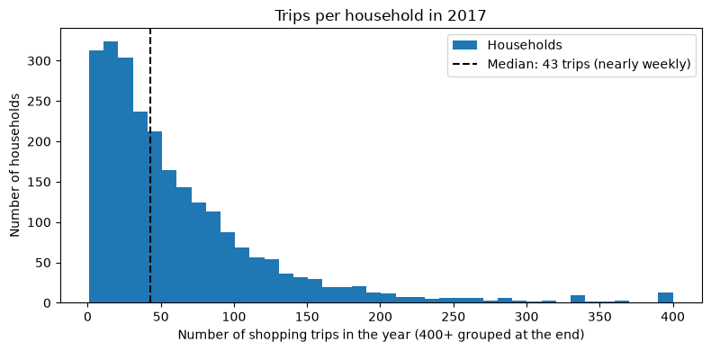
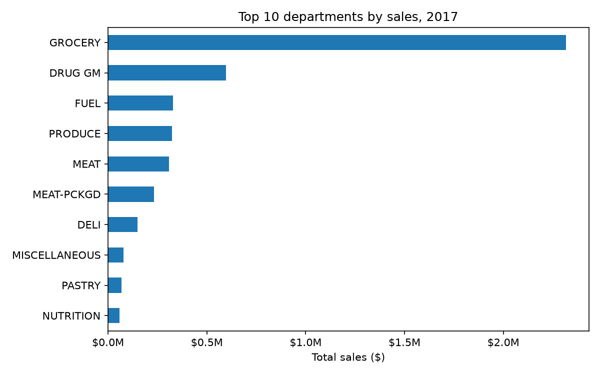
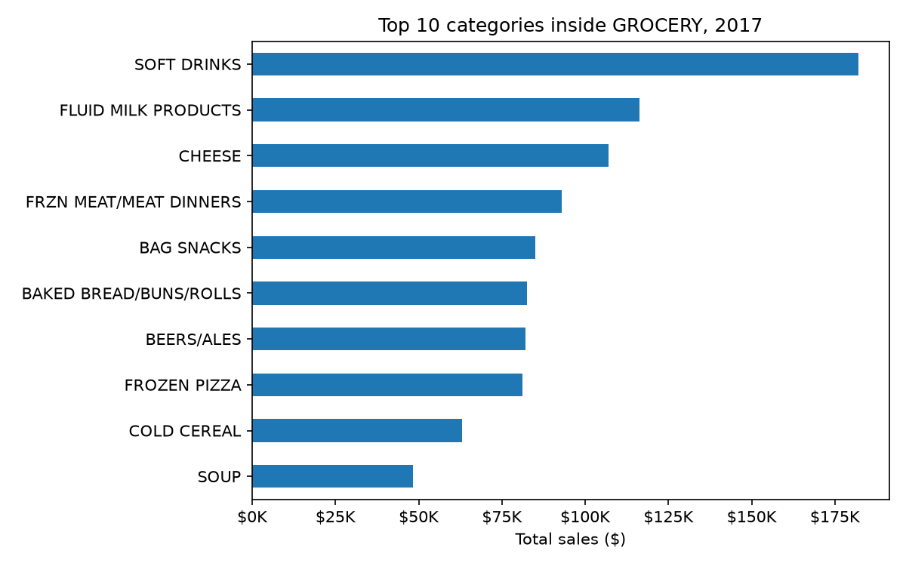
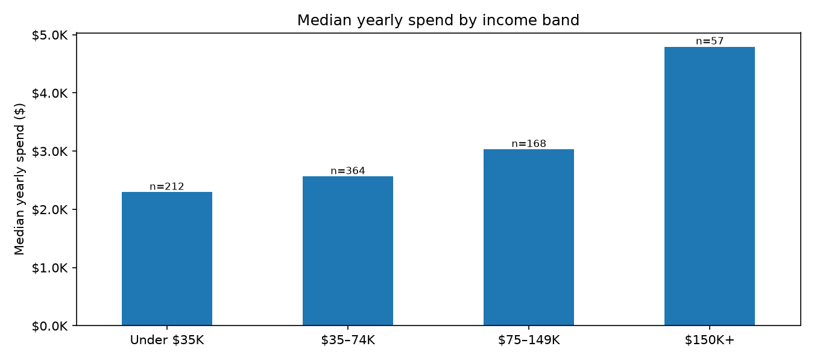
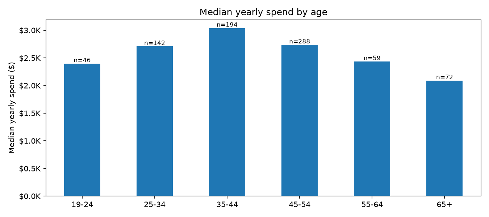
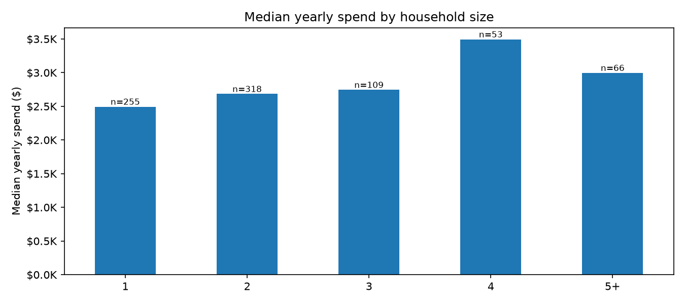
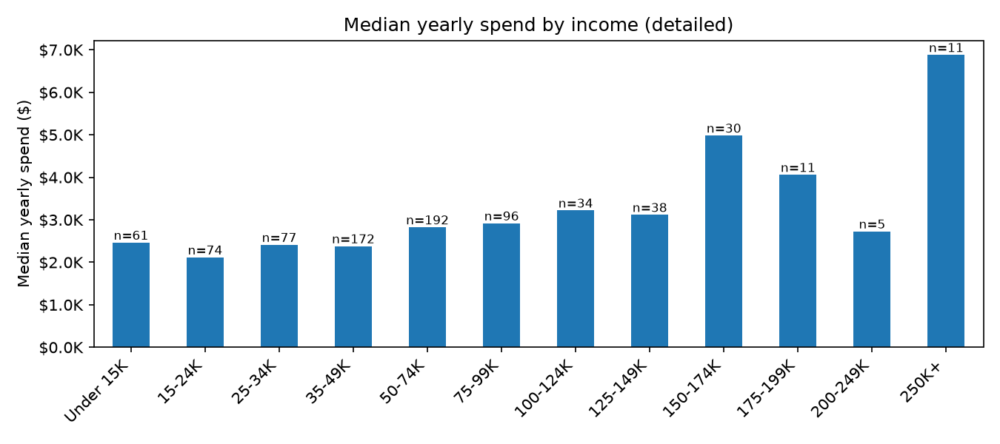
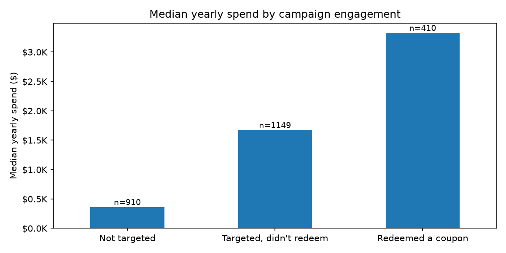
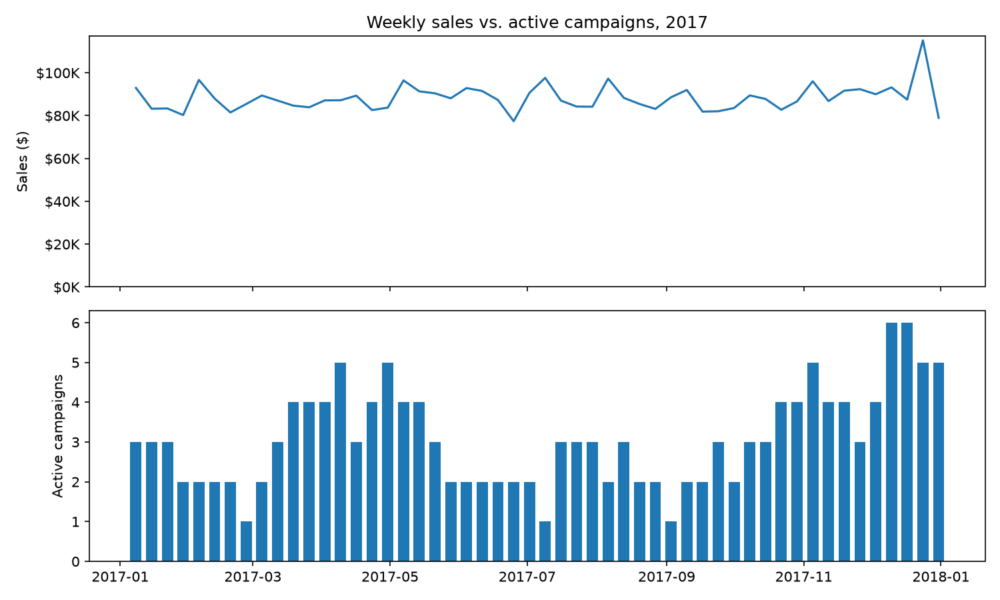

## 1. Weekly sales are stable all year

**Observation:** Sales averaged **$88.2K per week**, with half of all weeks between **$83.8K and $91.4K**. Week-to-week variation was only **6.9%**, which is very stable for retail.

**Peaks and dips:** The highest week ended **24 Dec 2017 ($115.1K)**, **31% above average**, driven by Christmas shopping. The lowest week ended **25 Jun 2017 ($77.4K)**, about 12% below average.

**So what:** There's no seasonal slump, so when a customer stops shopping, it's a real signal, not just a quiet season. That makes churn labels reliable.

**Next step:** Check whether the late-June dip and the recurring spikes near the start of some months line up with campaign dates in `campaign_descriptions`.

## 2. Most customers shop nearly weekly, and a small group drives a big share of visits

**Observation:** The typical household made **43 shopping trips** in 2017 (median), nearly once a week. The middle 50% made **20 to 83 trips**.

**Loyal core:** **42.9% of households (1,059)** shopped weekly or more, and **17.1% (422)** shopped twice a week or more.

**Concentration:** The **top 10% of households made 35% of all trips**. A small group of highly engaged customers drives over a third of store visits.

**Low-engagement group:** **120 households (4.9%)** made fewer than 5 trips all year. These are likely one-off or occasional shoppers rather than loyal customers who left.

**So what:**
- Because most customers shop nearly weekly, **a gap of several weeks is a strong early warning sign of churn.**
- The top 10% are the customers the business can least afford to lose. Losing one of them costs roughly as much as losing several typical customers, so **they should be the first priority for retention campaigns.**
- The under-5-trip group behaves differently and could distort the churn model.

**Next step:** Use "days since last trip" and "trips per month" as key churn features. Exclude households with fewer than 5 trips before the cutoff, and flag top-10% households so the app can prioritise them in win-back campaigns.

## 3. Half of all sales come from one department, and everyday staples lead it

**Observation:** Total 2017 sales were **$4.60M**. **GROCERY alone made up 50.4% (~$2.32M)**, followed by **Drug/General Merchandise (13.0%)** and **Fuel (7.2%)**. These top three departments account for **over 70% of all sales**.

**Fresh food:** **Produce (7.0%)** and **Meat (6.7%)**, plus **Packaged Meat (5.1%)**, together make up about **19%** of sales. Meat alone, fresh and packaged, adds up to **11.8%**.

**Inside GROCERY:** The top category is **Soft Drinks (~$182K)**, followed by everyday staples: **Fluid Milk (~$117K)**, **Cheese (~$107K)**, **Bread (~$82K)** and **Cold Cereal (~$63K)**. Convenience items also rank high: **Frozen Meals (~$93K)**, **Bag Snacks (~$85K)**, **Beer (~$82K)** and **Frozen Pizza (~$81K)**.

**So what:**
- **Staples like milk, bread and cheese are bought every week.** When a customer stops buying them, they've likely started shopping somewhere else. That makes "stopped buying staples" a strong early churn signal.
- **Fuel in the top 3** suggests many customers combine fuel and grocery trips, so a fuel-plus-grocery offer could be an easy win-back lever.
- **Convenience and treat categories** (soft drinks, snacks, beer, frozen pizza) are natural targets for promotions and social media campaigns.

**Next step:** Add churn features for spend share by department, especially grocery staples and fresh food, and a "dropped a regular category" flag. In the app, use each at-risk customer's favourite category to personalise their win-back offer.

## 4. Higher-income, mid-age family households spend the most

**Data note:** Demographics are available for **801 of 2,469 households (32%)**, so these patterns describe that subset. Every group shown has at least 46 households, except the detailed income bands above $175K (5–11 households each), which are combined into "$150K+".

**Income:** Median yearly spend rises steadily with income.

| Income band | Households | Median yearly spend |
|---|---|---|
| Under $35K | 212 | $2,294 |
| $35–74K | 364 | $2,564 |
| $75–149K | 168 | $3,030 |
| $150K+ | 57 | $4,793 |

Households earning **$150K+ spend about 2.1× as much** as those under $35K, and the **$75–149K group spends 32% more**.

**Age:** Spending follows an upside-down U. It rises from **$2,396 (19–24)** to a peak of **$3,038 (35–44)**, then falls to **$2,089 (65+)**. Shoppers aged **35–44 spend 45% more** than those aged 65+. The largest age group, **45–54 (288 households)**, spends **$2,735**, well above the youngest and oldest groups.

**Household size:** Spend grows with family size, from **$2,494 (1 person)** to **$3,494 (4 people)**, which is **40% more**. It dips slightly for 5+ (**$2,996**).

**So what:**
- The highest-value profile is **higher-income households aged 35–44 with 3–4 people.** Losing one of them costs far more revenue than losing an average customer, so they should get **priority in retention campaigns.**
- **Family-focused offers** (bulk packs, kids' staples, weekly meal bundles) fit this group naturally.
- **576 of 801 households (72%) earn under $75K.** For this majority, **value-led offers** like discounts and loyalty points are more likely to win them back than premium bundles.

**Next step:** Add age, income band and household size as churn model features. Because **68% of households have no demographics**, add a "demographics unknown" flag so the model can still learn from every customer.

## 5. Campaigns reach most customers, but the most-used type performs worst

**Reach:** 27 campaigns ran in 2017, reaching **1,559 of 2,469 households (63%)**. The typical reached household received **4 campaigns** (median), and some received up to **15**. **910 households (37%) were never targeted.**

**Response:** Only **410 households (26% of those reached)** ever redeemed a coupon. That leaves **1,149 targeted households who never responded.**

**Campaign type:**

| Type | Campaigns | Households reached | Redemption rate |
|---|---|---|---|
| A | 4 (15%) | 1,490 | **24.9%** |
| B | 17 (63%) | 995 | **11.7%** |
| C | 6 (22%) | 397 | **7.6%** |

**Type A converts more than 2× better than Type B and 3× better than Type C**, yet Type B made up **63% of all campaigns.** The dataset doesn't say how the types differ, and households can receive several types, so this shows *which* format performs best, not *why*.

**Spend by engagement:** Coupon redeemers spend a median of **$3,329/year**, which is **2× targeted non-redeemers ($1,674)** and **9× untargeted households ($364)**. Untargeted households already spent very little, which suggests the brand mostly targeted existing good customers. So redeemers spend more, but **this doesn't prove coupons caused the extra spending** (selection bias).

**Campaigns vs. sales:** Active campaigns ranged from **1 to 6 per week**, while weekly sales stayed within a narrow band (6.9% variation). The correlation between active campaigns and weekly sales was just **0.12**, essentially no relationship, so campaign volume doesn't move overall sales.

**So what:**
- **Shift budget towards Type A-style campaigns:** the least-used format is the best performer.
- **The 910 never-targeted, low-spend households are a blind spot.** They're likely the highest churn risk and get no retention effort.
- **More campaigns ≠ more sales.** Better *targeting* matters more than more *volume*. Some households receiving up to 15 campaigns may be experiencing campaign fatigue.

**Next step:** Add churn features for campaigns received, coupons redeemed and "stopped redeeming." Test whether never-targeted households churn more. In the app, recommend Type A-style offers for at-risk customers.

## 6. 1 in 5 regular customers pulled back sharply at year-end

**Definition:** Using January–October 2017 as the observation period and November–December as the outcome period, a regular customer (5+ trips before the cutoff) is labelled **at-risk ("silent churn")** if their **average weekly spend fell by 50% or more**, including those who stopped entirely.

**Result:** Of **2,297 regular customers**, **509 (22.2%)** were at-risk:
- **134 (5.8%)** stopped shopping completely.
- **375 (16.3%)** kept shopping but cut their spending by half or more.

The typical customer's spend was unchanged (median ratio **1.00**), so the at-risk group stands out clearly.

**Why silent churn instead of full churn:** Full churn (5.8%) catches customers only after they've gone. Silent churn flags them **while they're still shopping and can still be won back**, which is when retention campaigns work. The definition is also **conservative**: Christmas normally raises December spending, so anyone flagged pulled back during the busiest season of the year.

**Next step:** Use `silent_churn` as the model's target, with features built only from data before 31 Oct 2017 to avoid data leakage.

## 8. At-risk customers abandon their everyday essentials first

**Method:** For each at-risk segment, among customers who regularly bought a category ($0.50+/week), the share who cut it by 50%+ in the last 8 weeks of 2017, compared with healthy customers in the same value tier.

**Result:** Across all three segments, the most-dropped categories are weekly essentials:
- **Milk:** dropped by 72–87% of at-risk regular buyers vs 8–17% of healthy buyers (**4–10×**).
- **Bread:** 77–84% vs 13–17% (**5–6×**).
- **Cheese:** 71–80% vs 21% (**3–4×**, Core segments).
- **High-value customers** also stopped buying pantry staples: soup (100% of 18 regular buyers), shelf-stable vegetables (69%).

**Revenue at risk:** **$8,812/week** across 469 at-risk customers. The **34 high-value customers (7%) account for 29%** of it.

**So what:** Milk and bread are "anchor" items that decide where people do their weekly shop. When regulars stop buying them, they've moved their main shop elsewhere. A grocery owner should treat a regular's lapse in milk or bread as an early alarm, and win-back offers should target these anchor items first.

*Caveat: some categories have few regular buyers (11–18), so those rates are directional.*

